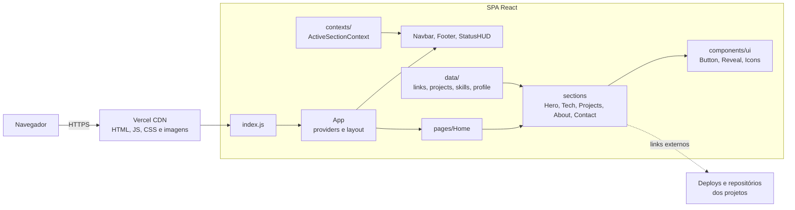

# Portfólio — Gabriel Fagundes

Portfólio de desenvolvedor full stack que mostra, em uma página só, os projetos publicados como estudos de caso (problema, stack e desafio técnico) para recrutadores de vagas Júnior e Estágio.

[](URL_DO_DEPLOY)


[](LICENSE)

**[Ver projeto online](URL_DO_DEPLOY)** · [Currículo (PDF)](public/curriculo-gabriel-fagundes.pdf) · [LinkedIn](https://www.linkedin.com/in/gabrielfagundesdeoliveira/)

> Este repositório é só front-end: o site é estático, sem API nem banco de dados próprios. Os projetos apresentados nele têm seus próprios repositórios de front e API, linkados em cada card.

## Prints

| Desktop                                                                       | Celular                                                                |
| ----------------------------------------------------------------------------- | ---------------------------------------------------------------------- |
|        |  |
|  |        |

## Funcionalidades

- Projetos como estudos de caso, do mais complexo ao mais simples, com um card maior em destaque
- Botões "Ver projeto" e "Ver código" (e "Código da API" quando existe); o de deploy some se o projeto não tiver um
- Stack separada entre "Uso no dia a dia" e "Tenho familiaridade"
- Menu que destaca a seção visível e menu mobile acessível por teclado
- Currículo em PDF para download no topo e no contato
- Preview com imagem ao compartilhar o link no LinkedIn e no WhatsApp (Open Graph)
- Layout responsivo de 360 a 1440 px e respeito a `prefers-reduced-motion`

## Stack

| Área               | Tecnologias                                                                                   |
| ------------------ | --------------------------------------------------------------------------------------------- |
| Front-end          | React 19, JavaScript (JSX), CSS Modules, React Icons, react-parallax-tilt                     |
| Animações          | CSS (keyframes) + `IntersectionObserver`; tsParticles no fundo do hero, carregado sob demanda |
| Build              | Create React App (`react-scripts` 5)                                                          |
| Testes e qualidade | Jest, Testing Library, ESLint (`eslint-config-react-app`), Prettier                           |
| Deploy             | Vercel                                                                                        |

## Arquitetura



Não há API: o conteúdo vive em arquivos de dados e a interface só lê esses dados. As camadas, de baixo para cima:

- **`data/`**: todo o conteúdo do site (projetos, stack, perfil, links). Para adicionar um projeto, basta editar `projects.js`; a UI não precisa mudar.
- **`pages/Home/sections/`**: cada seção da página lê os dados e monta a tela com os componentes.
- **`components/`**: layout (`Navbar`, `Footer`, `StatusHUD`, `Cursor`) e, em `ui/`, peças genéricas sem regra de negócio (`Button`, `Reveal`, `Icons`).
- **`contexts/` e `hooks/`**: estado compartilhado (seção ativa do menu) e hooks reutilizáveis (`useMediaQuery`).

```text
src/
├── App.jsx                 providers e layout
├── index.js                entrada
├── assets/projects/        screenshots dos projetos (WebP, 640 e 1200 px)
├── components/
│   ├── ui/                 Button, Reveal, Icons
│   └── Navbar/ Footer/ StatusHUD/ Cursor/
├── contexts/               ActiveSectionContext
├── data/                   links, projects, skills, profile, navigation
├── hooks/                  useMediaQuery
├── pages/Home/             Home.jsx + sections/
└── styles/                 globals.css (tokens e reset)
```

## Desafios técnicos

### 1. Menu marcando a seção errada

- **Problema:** com a tela em "Projetos", o menu destacava "Stack". A versão anterior comparava `intersectionRatio`, que é a fração visível _de cada seção_. Assim, uma seção curta sempre "ganhava" de uma longa.
- **Solução:** um único `IntersectionObserver` com `rootMargin: "-49% 0px -50% 0px"`, que reduz a área observada a uma faixa fina no centro da tela. A seção ativa é a que cruza essa faixa. O valor é distribuído por contexto (`ActiveSectionContext`) para o menu e o HUD.
- **Por quê:** o resultado não depende da altura de cada seção. Um observer só, em vez de um por componente, e o provider evita re-renderizar a página inteira a cada troca. Testei rolando a página toda: o item certo ficou ativo em 41 de 41 posições.

### 2. Links quebrados que ninguém percebia

- **Problema:** os links do GitHub apontavam para um usuário errado e para repositórios que não existiam, e um botão apontava para `#`.
- **Solução:** todos os links ficam em `src/data/links.js`, e as URLs do GitHub são montadas a partir de uma única constante (`GITHUB_USER`). O teste `links.test.js` falha se algum link ficar vazio, apontar para `#`, não usar HTTPS ou sair do usuário certo.
- **Por quê:** o erro deixa de depender de alguém clicar em cada botão. Ele aparece no `npm test`.

### 3. Performance no celular: de 63 para 91 no Lighthouse

- **Problema:** a nota de performance no mobile era 63. O Framer Motion e o GSAP ocupavam um terço do bundle só para fades na entrada. Ao trocá-los, apareceu um problema menos óbvio: o Lighthouse retornava `NO_LCP`, porque o Chrome ignora, no cálculo do LCP, elementos que começam com `opacity: 0`, e toda a primeira dobra começava assim.
- **Solução:**
  - as animações viraram CSS, disparadas por um componente `Reveal` com `IntersectionObserver`;
  - a foto do hero, o maior elemento da dobra, anima só com escala, sem fade, e é pré-carregada no HTML;
  - as imagens viraram WebP com `srcset` e `loading="lazy"`;
  - as partículas só carregam em telas grandes.
- **Por quê:** o bundle principal caiu de 195 KB para 86 KB (gzip), e a métrica de LCP voltou a refletir o que o usuário vê.

| Lighthouse (build de produção, medição local) | Performance | Acessibilidade | Boas práticas | SEO |
| --------------------------------------------- | ----------- | -------------- | ------------- | --- |
| Mobile                                        | 91          | 100            | 100           | 100 |
| Desktop                                       | 99          | 100            | 100           | 100 |

## Como rodar localmente

**Pré-requisitos:** Node.js 18 ou superior (testado com o 24) e npm.

```bash
git clone https://github.com/GabrielFagundes18/portNovo.git
cd portNovo
npm ci
npm run dev        # http://localhost:3000
```

**Variáveis de ambiente:** nenhuma é obrigatória. Os padrões ficam em `.env.development` e `.env.production`. Para sobrescrever na sua máquina, copie `.env.example` para `.env.local`; cada variável está explicada no arquivo.

| Comando                           | O que faz                                                                    |
| --------------------------------- | ---------------------------------------------------------------------------- |
| `npm run dev`                     | Servidor de desenvolvimento com recarga automática (`npm start` faz o mesmo) |
| `npm run build`                   | Build de produção em `build/`                                                |
| `npm test`                        | Roda os testes uma vez                                                       |
| `npm run test:watch`              | Testes em modo interativo                                                    |
| `npm run lint`                    | ESLint em `src/`, falha com qualquer warning                                 |
| `npm run format` / `format:check` | Formata ou confere a formatação com Prettier                                 |

**Deploy:** a Vercel faz o build a cada push na `main`. As meta tags de Open Graph precisam de URL absoluta. Por isso, `.env.production` usa `VERCEL_PROJECT_PRODUCTION_URL`, que a Vercel preenche com o domínio de produção.

## Testes

```bash
npm test
```

São 7 testes em 2 suítes:

- **`src/data/links.test.js`:** nenhum link vazio ou `#`, links externos em HTTPS, todo link do GitHub no usuário certo, todo projeto com repositório e exatamente um projeto em destaque.
- **`src/pages/Home/sections/Projects/ProjectCard.test.jsx`:** o card mostra "Ver projeto" e "Ver código" com as URLs certas, esconde "Ver projeto" quando não há deploy e abre links externos em nova aba com `rel="noopener noreferrer"`.

O menu (seção ativa, teclado, menu mobile) e a responsividade foram verificados com um navegador headless durante o desenvolvimento, mas esses testes ainda não estão no repositório (veja os próximos passos).

## Próximos passos

- **Testes end-to-end com Playwright** para o menu (seção ativa, foco preso, `Esc`) e para a ausência de scroll horizontal de 360 a 1440 px, rodando no GitHub Actions junto com lint e testes.
- **Migrar de Create React App para Vite**, já que o CRA não é mais mantido: build mais rápido e dependências atualizadas.
- **Migrar para TypeScript**, começando pelos arquivos de `data/`, onde tipar a estrutura de um projeto evita card com campo faltando.

## Autor

**Gabriel Fagundes**: desenvolvedor full stack, em busca de vaga Júnior ou de Estágio em Guarulhos/SP.

- Portfólio: [URL_DO_DEPLOY](URL_DO_DEPLOY)
- LinkedIn: [linkedin.com/in/gabrielfagundesdeoliveira](https://www.linkedin.com/in/gabrielfagundesdeoliveira/)
- GitHub: [github.com/GabrielFagundes18](https://github.com/GabrielFagundes18)
- E-mail: [gabrielfagundesvv@gmail.com](mailto:gabrielfagundesvv@gmail.com)

Código sob licença [MIT](LICENSE). Foto, currículo e screenshots não estão incluídos na licença.
